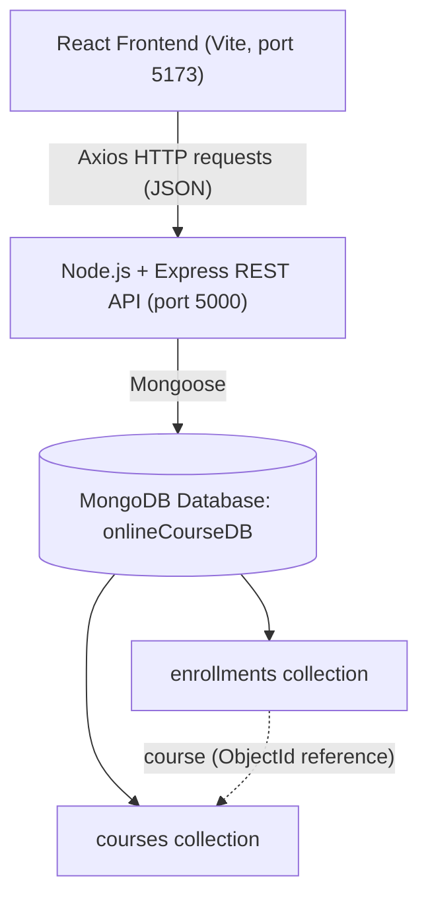

# Project Overview - CourseHub Online Course Management System

## 1. Problem statement
Students need one place to discover online courses, read what each course offers, and register. Administrators need a simple way to maintain the course catalogue and see enrollment records. Doing this with spreadsheets or static pages is error-prone: information goes out of date, duplicate registrations happen, and there is no search.

## 2. Objectives
1. Identify and organize the application's modules (courses, enrollments, dashboard).
2. Build a React user interface with routing.
3. Build a Node.js + Express REST API.
4. Store data in MongoDB using Mongoose schemas.
5. Connect React and Express using Axios.
6. Match every frontend request to a backend route.
7. Implement full Create, Read, Update, Delete for courses and enrollments.
8. Validate input on the client, the server, and the database schema, and handle errors.
9. Test the important operations.
10. Demonstrate a working application.

## 3. Technology stack
| Area | Tools |
|------|-------|
| Frontend | React 18, Vite 5, React Router 6, Axios, Lucide React, plain CSS |
| Backend | Node.js, Express 4, Mongoose 8, cors, dotenv, nodemon (dev) |
| Database | MongoDB Community Server (local), database `onlineCourseDB` |
| Tools | Visual Studio Code, Windows PowerShell / Command Prompt, MongoDB Compass |

## 4. System architecture

**Data flow.** A user action in a React page (for example submitting the enrollment form) calls a function in `src/api/`. That function uses the shared Axios instance (base URL from `VITE_API_URL`) to send an HTTP request to Express. Express passes it through CORS and JSON parsing, a route file selects a controller, and the controller validates the input and uses a Mongoose model to read or write MongoDB. The controller returns JSON of the form `{ success, message, data }`. Axios resolves with that JSON, the React page updates its state (or re-fetches the list), and the UI re-renders with the real stored data. Errors travel the same way in reverse as a non-2xx status plus a message that the page displays.

## 5. Frontend modules
| Module | Files | Purpose |
|--------|-------|---------|
| API client | `src/api/axios.js`, `courseApi.js`, `enrollmentApi.js`, `dashboardApi.js` | One configured Axios instance; one small function per endpoint |
| Pages | `src/pages/*.jsx` | Home, Courses, CourseDetails, Enroll, Enrollments, ManageCourses, AddCourse, EditCourse, NotFound |
| Components | `Navbar`, `Footer`, `CourseCard`, `CourseForm`, `Modal`, `ConfirmDialog`, `Alert`, `Loading`, `ErrorMessage`, `EmptyState` | Reusable UI |
| Utilities | `utils/helpers.js`, `hooks/useDebounce.js` | Formatting, validation rules, error parsing, debounced search |
| Styles | `styles/global.css`, `styles/components.css` | Design tokens, responsive layout |

## 6. Backend modules
| Module | Purpose |
|--------|---------|
| `server.js` | Loads `.env`, connects to MongoDB, starts listening only after the connection succeeds |
| `app.js` | Express app: CORS allow-list, JSON body limit (100 KB), health check, routes, 404 and error handlers |
| `config/db.js` | Mongoose connection with a clear error message |
| `models/` | `Course` and `Enrollment` schemas |
| `controllers/` | Business logic for courses, enrollments, and dashboard statistics |
| `routes/` | URL-to-controller mapping |
| `middleware/errorMiddleware.js` | `asyncHandler`, ObjectId validation, "database offline" guard, uniform JSON errors |
| `scripts/seed.js` | Optional, idempotent sample data |

## 7. Database schema

**Course** (`courses` collection)
| Field | Type | Rules |
|-------|------|-------|
| title | String | required, trimmed, max 150 |
| description | String | required, max 5000 |
| instructor | String | required |
| category | String | required |
| level | String | `Beginner` / `Intermediate` / `Advanced` (default Beginner) |
| durationWeeks | Number | required, 1 to 520 (stored in weeks) |
| price | Number | required, minimum 0 |
| imageUrl | String | optional, must start with http:// or https:// |
| prerequisites | String | optional |
| learningOutcomes | [String] | optional |
| createdAt, updatedAt | Date | automatic timestamps |

**Enrollment** (`enrollments` collection)
| Field | Type | Rules |
|-------|------|-------|
| studentName | String | required, 2-100 chars |
| email | String | required, valid format, stored lowercase |
| phone | String | required, 7-20 digits (+ - ( ) and spaces allowed) |
| course | ObjectId -> Course | required, must exist |
| enrollmentDate | Date | defaults to now |
| status | String | `Enrolled` / `In Progress` / `Completed` / `Cancelled` |
| createdAt, updatedAt | Date | automatic timestamps |

Unique compound index on `(email, course)` prevents duplicate enrollments. Duplicate-key errors (code 11000) are converted to a `409` response.

**Course deletion rule:** a course with enrollments cannot be deleted (`409`). This is the simplest safe approach and means no enrollment ever points at a missing course.

## 8. CRUD workflow
| Action | Frontend | API | Result |
|--------|----------|-----|--------|
| Create course | Add Course form | `POST /api/courses` | Saved; redirect to Manage Courses with a success message |
| Read courses | Courses, Home, Manage | `GET /api/courses` (search, category, level) | Rendered from MongoDB |
| Read one course | Course Details, Edit | `GET /api/courses/:id` | 404 shows a not-found page |
| Update course | Edit Course form | `PUT /api/courses/:id` | Form re-synced with the saved document |
| Delete course | Manage Courses + confirm dialog | `DELETE /api/courses/:id` | List and stats re-fetched; 409 error shown if enrolled |
| Create enrollment | Enroll form | `POST /api/enrollments` | Success shown only after the server confirms |
| Read enrollments | My Enrollments | `GET /api/enrollments` (search, status, courseId) | Course is populated |
| Update enrollment | Edit dialog | `PUT /api/enrollments/:id` | List re-fetched |
| Delete enrollment | Confirm dialog | `DELETE /api/enrollments/:id` | List re-fetched |

## 9. API integration
- All HTTP calls go through `src/api/axios.js`. The base URL comes from `VITE_API_URL`, so no URL is hard-coded in components.
- Every response has the shape `{ success, message, data }` (lists also include `count`; errors may include an `errors` array of field messages).
- `parseError()` in `utils/helpers.js` turns any failure into a readable message, including the case where the backend cannot be reached.
- Pages abort in-flight requests when filters change or the page unmounts, so old responses never overwrite new ones.
- Forms disable their submit button while a request is running to prevent double submission.

## 10. Known limitations
- **No authentication or authorization.** Anyone can view or change all courses and enrollments. This is a lab demo, not a secure admin system.
- No pagination: lists load all matching records (fine for a lab-sized dataset).
- No payment processing; "price" is informational.
- Single currency (INR) and duration only in weeks.
- No automated frontend tests; backend tests are documented in TESTING_CHECKLIST.md.
- The seed script and unique index assume a standard local MongoDB.

## 11. Future enhancements
- User accounts with login (JWT or sessions) and roles (student, instructor, admin); students would see only their own enrollments.
- Pagination and sorting on the API and in the tables.
- Course images upload, lessons/modules, progress tracking, and certificates.
- Email confirmations on enrollment.
- Automated tests (Jest + Supertest for the API, Vitest + Testing Library for React).
- Deployment with MongoDB Atlas, an environment-specific CORS list, and rate limiting.
